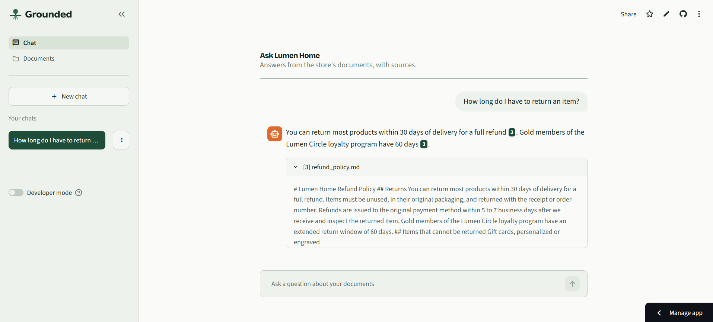
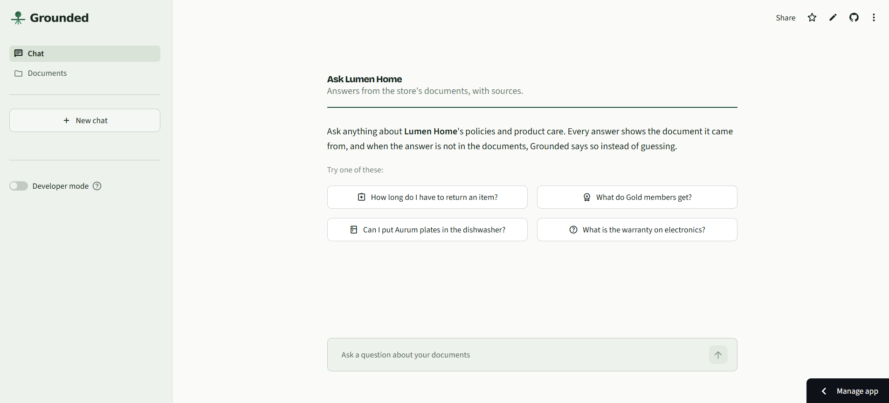
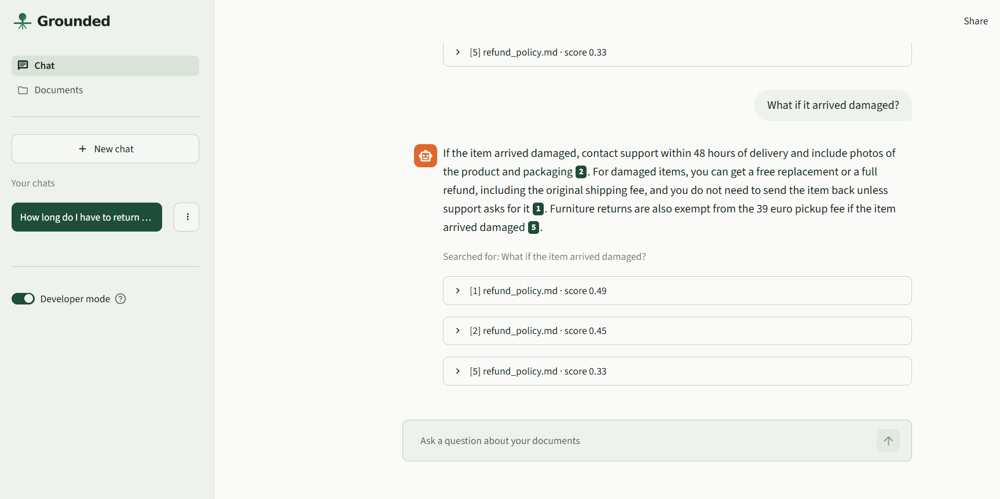
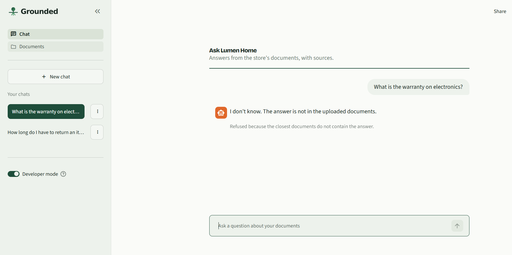

# Grounded

A RAG chatbot that answers questions from your documents, cites the exact source of every answer, and refuses when the answer is not in the documents.

**Live demo:** https://grounded-rag.streamlit.app

The demo answers from the knowledge base of Lumen Home, a fictional online home goods store: refund and shipping policies, payments, account and privacy, an FAQ, and two PDF guides.



## What it does

- **Answers only from your documents.** The model is instructed to use only the retrieved sources, never its own knowledge.
- **Cites every answer.** Each fact is tagged with a source number, and the source box shows the file, the page for PDFs, and the exact text.
- **Refuses safely.** If the documents do not contain the answer, it says so instead of guessing.
- **Understands follow-up questions.** "Who pays the shipping for that?" is rewritten into a full question before searching.
- **Saves chats.** Conversations are stored per visitor and can be renamed or deleted.
- **Streams answers** word by word.

| Welcome | Follow-up question | Safe refusal |
|---|---|---|
|  |  |  |

## How it works

**Indexing a document**

1. The file is read page by page (PDF, TXT or MD).
2. Each page is split into 500 character chunks with 75 characters of overlap.
3. Each chunk is turned into an embedding with OpenAI `text-embedding-3-small`.
4. Chunks and embeddings are stored in Postgres with pgvector.

**Answering a question**

1. A follow-up question is rewritten into a standalone question using the recent chat.
2. pgvector finds the 5 chunks closest in meaning to the question.
3. The model answers using only those chunks and cites each fact.
4. Three checks decide whether the answer is shown or refused.

**The three refusal checks**

| Check | What it catches | Example |
|---|---|---|
| Similarity threshold | Questions unrelated to the documents. Refused before calling the model. | "What is the capital of France?" |
| Model confirms the answer is in the sources | Questions on topic but not answered by the documents | "What is the warranty on electronics?" |
| Answer must cite a source | Answers that cannot be linked to any retrieved chunk | Any uncited answer |

## Evaluation

A test set of 25 questions in `eval/questions.json` checks both answers and refusals:

- **17 answer questions:** each must contain the right fact and cite the right file and page.
- **5 near-miss questions:** they sound related to the store but are not answered by the documents.
- **3 out of scope questions:** unrelated to the store.

| Setting | Passed | Lowest correct answer score | Highest near-miss score |
|---|---|---|---|
| 1000 character chunks, threshold 0.35 | 23/25 | 0.34 | 0.47 |
| 1000 character chunks, threshold 0.25 | 25/25 | 0.34 | 0.47 |
| **500 character chunks, threshold 0.25** | **25/25** | **0.38** | **0.45** |

Smaller chunks raised the scores of correct answers because each chunk covers one topic. Near-miss questions score as high as real ones, so a threshold alone cannot catch them. That is why the model must also confirm the answer is in the sources.

Run it yourself:

```bash
python -m eval.run_eval
```

## Tech stack

- **App:** Python, Streamlit
- **AI:** OpenAI API (`gpt-5.4-mini` for answers and query rewriting, `text-embedding-3-small` for embeddings)
- **Database:** Postgres with pgvector, migrations with Alembic
- **Hosting:** Streamlit Community Cloud and Neon

## Project structure

```
├── app.py                  # entry point and page navigation
├── rag/                    # all RAG logic, independent of the UI
│   ├── loader.py           # read PDF, TXT and MD files
│   ├── chunker.py          # split text into overlapping chunks
│   ├── embedder.py         # create embeddings
│   ├── store.py            # save and delete documents and chunks
│   ├── retriever.py        # vector similarity search
│   ├── rewriter.py         # rewrite follow-up questions
│   ├── prompt.py           # grounded prompt and citation rules
│   ├── answer.py           # streaming answers with the three refusal checks
│   ├── chats.py            # saved chats and messages
│   └── limits.py           # daily question limits for the public demo
├── ui/                     # Streamlit pages and components
├── alembic/                # database migrations
├── eval/                   # test questions and evaluation script
└── data/sample_docs/       # Lumen Home demo documents
```

The `rag` package has no Streamlit code, so the same logic can sit behind an API and power a chat widget in any website or app.

## Run it locally

Requirements: Python 3.11 or newer, Docker, and an OpenAI API key.

```bash
git clone https://github.com/samuelbrhane/rag-document-chatbot.git
cd rag-document-chatbot
python -m venv .venv
source .venv/bin/activate        # Windows: .venv\Scripts\activate
pip install -r requirements.txt
```

Copy `.env.example` to `.env` and add your OpenAI key, then start the database and create the tables:

```bash
docker compose up -d
alembic upgrade head
```

Start the app and upload the files from `data/sample_docs` on the Documents page:

```bash
streamlit run app.py
```

## Configuration

| Variable | Purpose | Default |
|---|---|---|
| `OPENAI_API_KEY` | OpenAI API key | required |
| `DATABASE_URL` | Postgres connection string | required |
| `CHAT_MODEL` | model for answers and rewriting | `gpt-5.4-mini` |
| `EMBEDDING_MODEL` | model for embeddings | `text-embedding-3-small` |
| `DEMO_MODE` | read-only documents and daily question limits | `false` |
| `DAILY_QUESTIONS_PER_VISITOR` | question limit per visitor in demo mode | `20` |
| `DAILY_QUESTIONS_TOTAL` | total daily question limit in demo mode | `300` |

## License

MIT